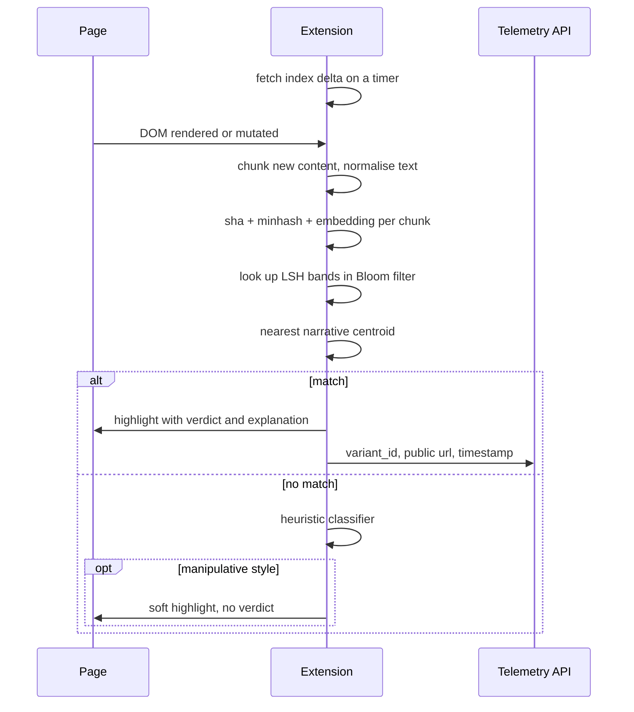
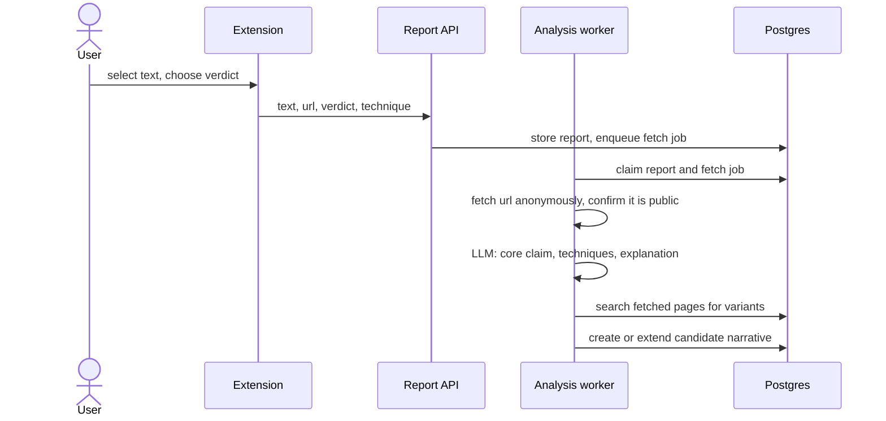
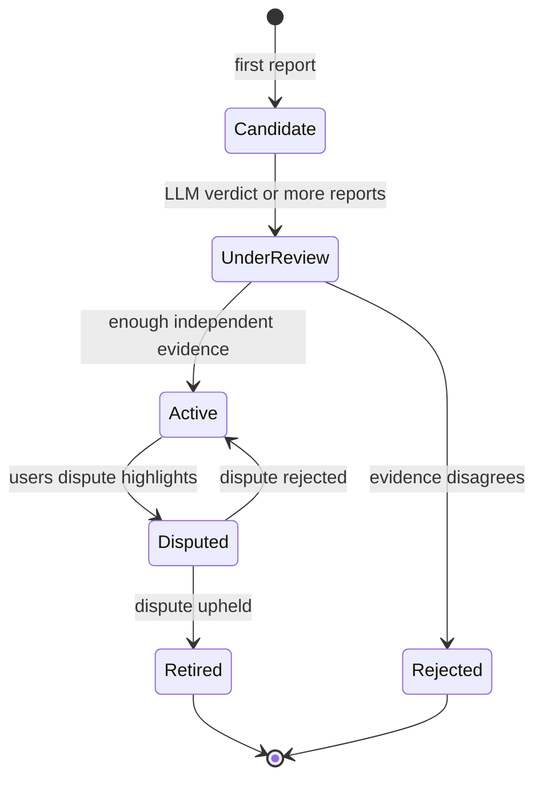

# Architecture

The goals are in [north-star.md](north-star.md), the data model in [data-model.md](data-model.md) and the technology choices in [decisions.md](decisions.md).

The system has two halves. The extension fingerprints and matches content locally against a downloaded signature index. The backend builds that index from user reports, EUvsDisinfo cases and the public pages it fetches, and keeps the narrative graph. The C4 diagrams and the component list are in [components.md](components.md).

## Scanning a page

Everything up to the telemetry call runs in the browser.

## Reporting

A report is the only path through which text a user reads reaches the backend.

## Signature lifecycle

Clients receive Active signatures as verdicts and UnderReview signatures as soft warnings. Allowlist entries attach to a signature and suppress it on specific domains, such as fact-checkers quoting the claim.
