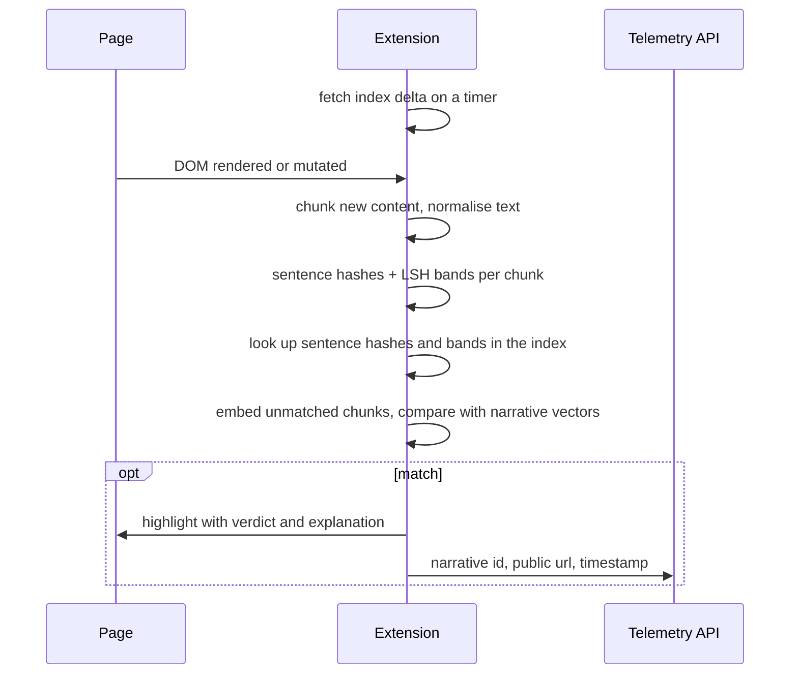
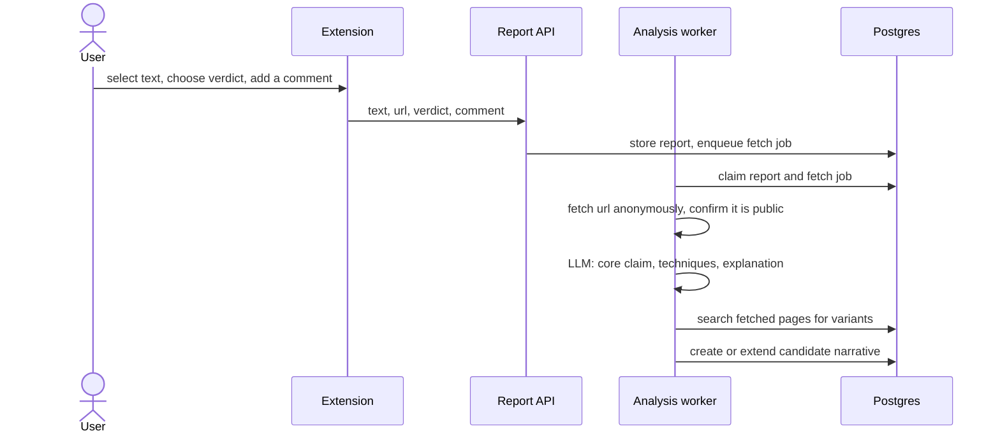
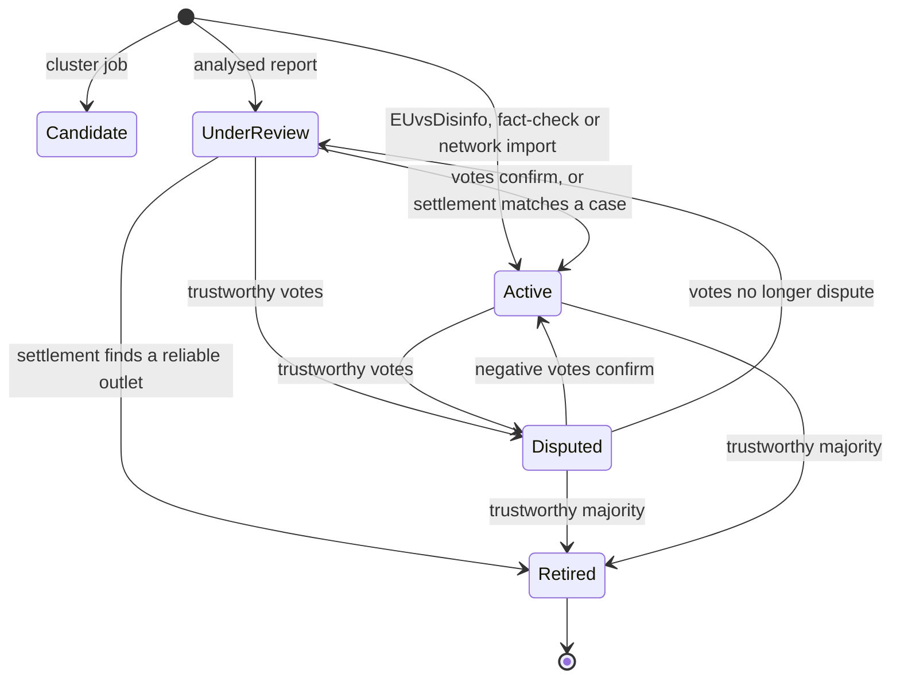

# Architecture

The goals are in [north-star.md](north-star.md), the data model in [data-model.md](data-model.md) and the technology choices in [decisions.md](decisions.md).

The system has two halves. The extension fingerprints and matches content locally against a downloaded signature index. The backend builds that index from user votes and reports, EUvsDisinfo cases, fact-checks, the Pravda network and the public pages it fetches, and keeps the narrative graph. The C4 diagrams and the component list are in [components.md](components.md).

## Scanning a page

Everything up to the telemetry call runs in the browser.

## Reporting

A report is the only path through which text a user reads reaches the backend.

## Signature lifecycle

Clients receive Active signatures as verdicts and UnderReview and Disputed signatures as soft warnings. A Candidate narrative is not shipped. Votes never move EUvsDisinfo or fact-checker narratives, and a narrative with `settled_at` set keeps its state.
