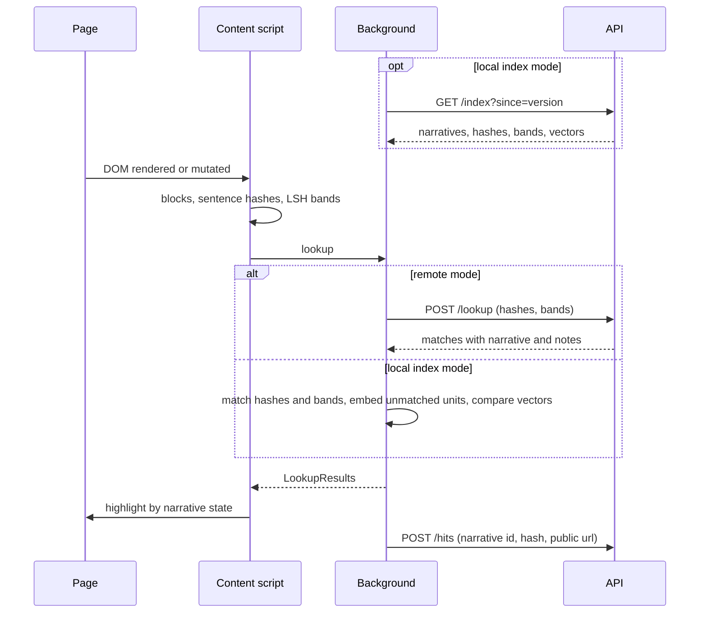
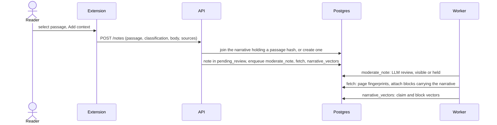
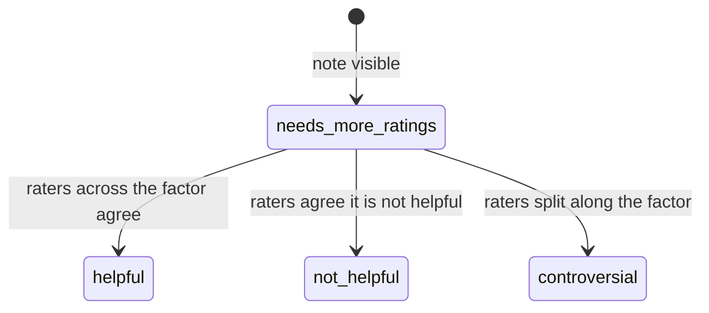
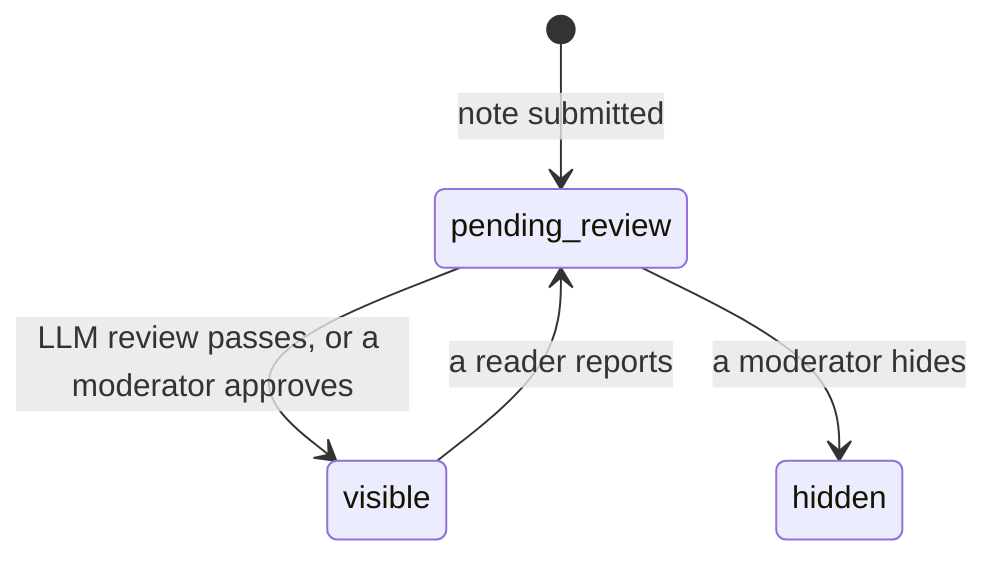

# Architecture

The goals are in [north-star.md](north-star.md), the contracts in [api.md](api.md), the tables in [data-model.md](data-model.md) and the containers in [components.md](components.md).

Konklaavi has two halves. Fingerprint tracking recognises that a passage belongs to a narrative and records where the narrative has spread, without judging it. Context notes attach readers' judgements to a narrative, and a scoring job decides which of them are shown. A narrative exists because a reader wrote a note on one of its passages.

## Scanning a page

The content script splits the page into blocks, hashes every sentence and computes each block's content hash and MinHash LSH bands. In remote mode it sends those hashes to `/lookup`. In local index mode the background keeps the downloaded index and matches there, and the offscreen document embeds sentences and three-sentence windows for narrative-level matching. Page text stays in the browser in both modes.

Each detection hit enqueues at most one fetch of its URL per day. The fetch job fingerprints the page and attaches the blocks that carry the narrative, so a narrative's spread grows wherever extension users meet it.

## Adding a note

Selecting a passage and adding a note is the only way page text reaches the backend.

## Rating and scoring

Readers rate notes from the highlight card. Every five minutes `score_notes` fits the Community Notes matrix factorisation over the ratings, each account once and each install without one on its own, and sets each note's status. The narrative's display state follows its shown notes, and every change marks the narrative changed for the next `/index` delta.

Each run fits the model afresh, so a decided note moves to another status when new ratings change the fit.

A narrative is misleading when a misleading note is helpful, context when a not-misleading note is helpful, controversial, needs ratings, or tracked when no note is shown. Reputation is recomputed from the same decisions.

## Moderation

Held and reported notes wait in the dashboard's moderation queue. A narrative whose every note is hidden is not shipped.
