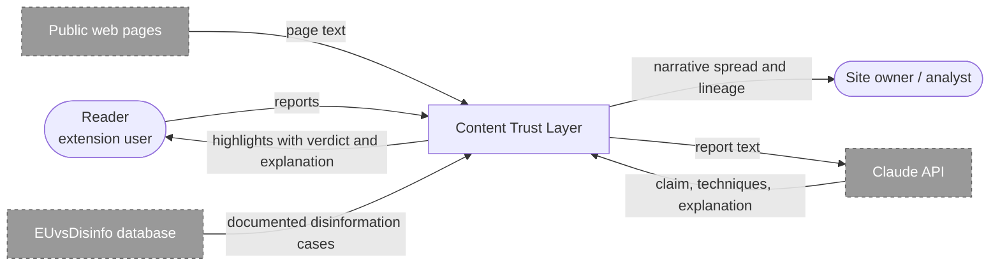
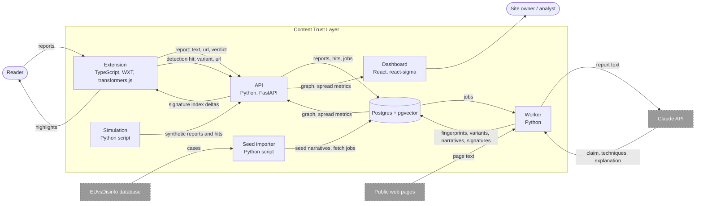
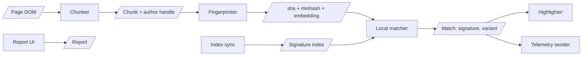
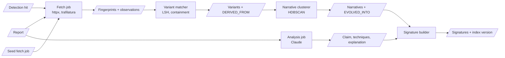

# Components

This page breaks the system into components that can be built in parallel. The flows are in [architecture.md](architecture.md) and the tables in [data-model.md](data-model.md). Arrows show the data that moves between components.

## Context

## Containers

The job queue is a table in Postgres. Workers claim jobs with `SELECT ... FOR UPDATE SKIP LOCKED`, and the periodic jobs re-enqueue themselves.

## Extension components

## Worker components

The fetch job fetches a URL anonymously, which also confirms it is public, then extracts the text, chunks it and fingerprints each chunk. Reports, detection hits and the seed importer all enqueue fetch jobs, so the graph grows wherever known narratives appear.

## Component list

- Fingerprint library: chunk normalisation, SHA-256, MinHash and LSH bands, and the embedding model, implemented in both TypeScript and Python. A shared JSON file of test vectors keeps the two implementations producing identical output.
- Extension: chunker, fingerprinter, index sync, local matcher, highlighter, report UI and telemetry sender.
- API: index deltas, reports, detection hits, and graph and metrics queries for the dashboard.
- Worker: fetch job, variant matcher, narrative clusterer, analysis job and signature builder.
- Seed importer: reads EUvsDisinfo cases into narratives with verdicts and explanations, and enqueues fetch jobs for the outlet URLs each case links to.
- Dashboard: narrative graph, lineage tree and spread over time.
- Simulation: synthetic honest, lazy, partisan and coordinated users sending reports and hits through the API, plus the evaluation of precision and false-positive rate.
- Database: schema migrations as plain SQL files.

## Contracts

Parallel work depends on four contracts, written together at the start:

- The SQL schema, including the jobs table.
- The fingerprint specification and its test vectors.
- The API request and response shapes, including the index format.
- The job types and their payloads.

## Workstreams

- Extension: everything in the extension, with the TypeScript fingerprinter.
- Content pipeline: the Python fingerprinter, fetch job, variant matcher and lineage.
- Backend core: schema, API, analysis job, signature builder and index build.
- Data and evaluation: seed importer, narrative clusterer, dashboard and simulation.

The EUvsDisinfo cases are split into a seed set, which populates the index, and an evaluation set, which measures how well the system finds narratives it was not seeded with. Pages from reliable outlets serve as negatives for the false-positive rate.
