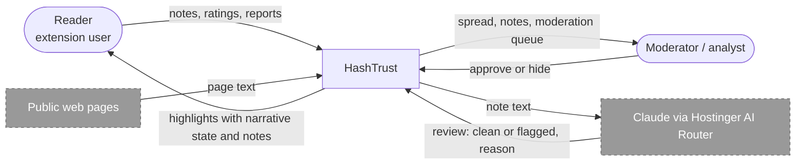
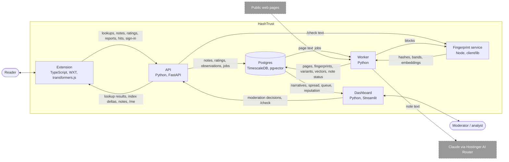
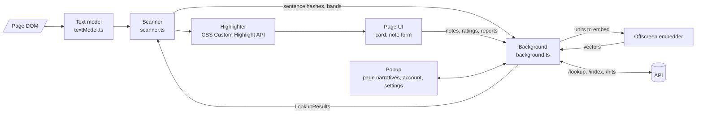
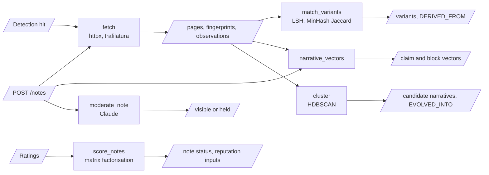

# Components

The flows between these components are in [architecture.md](architecture.md), their contracts in [api.md](api.md) and the tables in [data-model.md](data-model.md). Arrows show the data that moves.

## Context

## Containers

The job queue is a table in Postgres. Workers claim jobs with `SELECT ... FOR UPDATE SKIP LOCKED`, and the worker enqueues `cluster`, `narrative_vectors` and `score_notes` every five minutes.

## Extension

The content script never modifies the page DOM: highlights are CSS Custom Highlight ranges and the card and the note form live in a Shadow DOM. Every network call goes through the background, which picks the mock backend, the remote API or the local index from the settings.

## Worker

## Component list

- Fingerprint library: normalisation, sentence splitting, sentence and content hashes, MinHash and LSH bands, embedding units and the int8 vector format, written once in TypeScript in `client/lib/`. The extension bundles it, and the fingerprint service runs it in Node.
- Extension: the scanner, highlighter and page UI in the content script, the background with the local index, the offscreen embedder and the popup.
- API: lookup, `/check` and the index; notes, ratings, reports and the moderation queue; sign-in by email and password, and `/me`; detection hits.
- Worker: `fetch`, `match_variants`, `narrative_vectors`, `cluster`, `score_notes` and `moderate_note`.
- Dashboard: Streamlit pages for narratives and their spread, a narrative's detail, notes, the moderation queue, reputation and checking a text. It reads Postgres directly and acts through the API.
- Offline benchmark: imports EUvsDisinfo cases into its own database and measures narrative recognition, described in [evaluation.md](evaluation.md).
- Database: plain SQL migrations in `backend/migrations/`, applied in filename order at API and worker startup.
