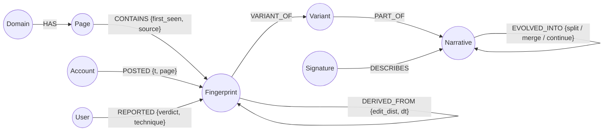
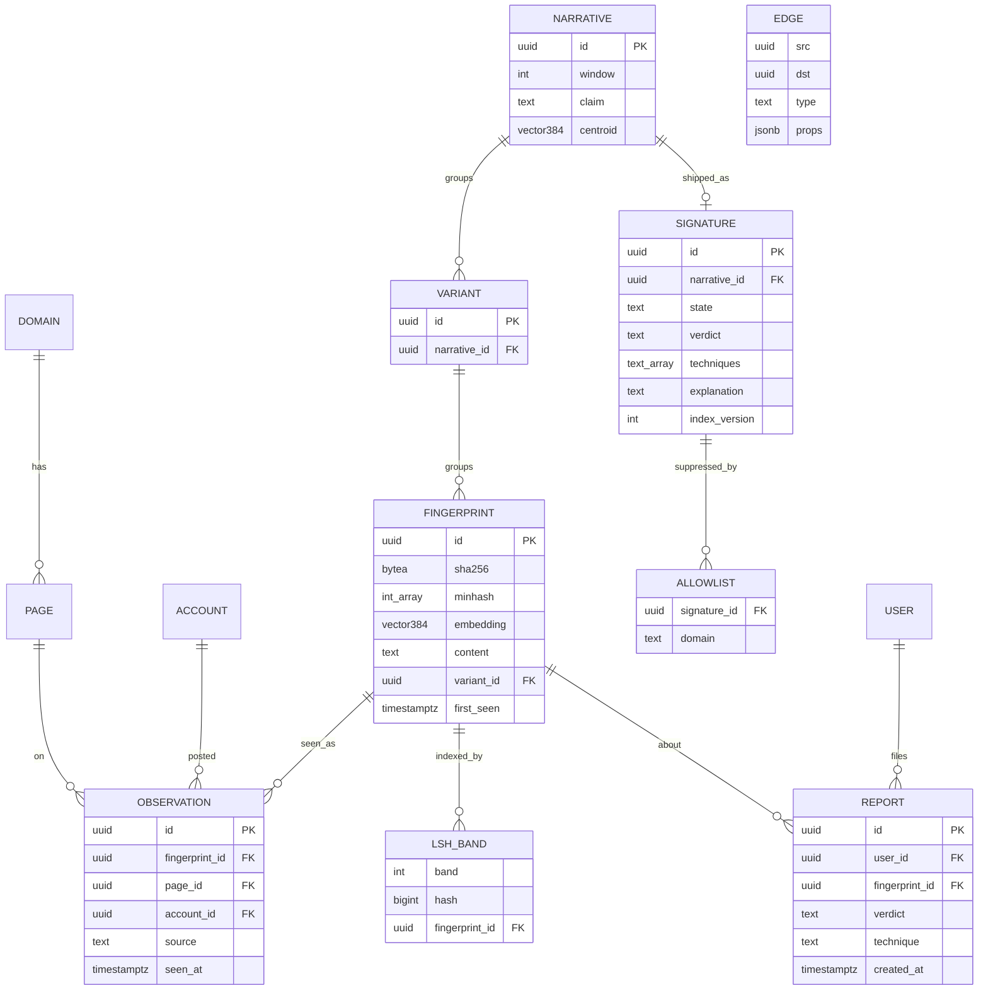
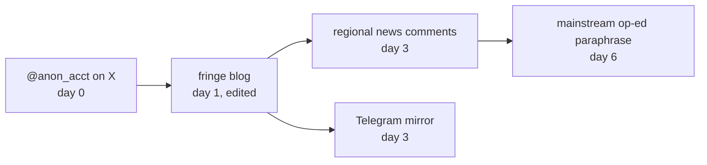

# Data model

Content is identified at three levels:

- Exact: the same text, matched by SHA-256 of the normalised text.
- Variant: an edited copy, matched by MinHash over word shingles with LSH.
- Narrative: the same claim in different words, matched by clustering embeddings.

Fingerprints enter the database from two sources: the crawler, which fetches public pages, and user reports. Detection hits from clients add observations of known variants at public URLs, which give the reach and spread of a narrative.

## Graph

Two edge types describe how narratives evolve:

- `DERIVED_FROM` links a fingerprint to the most similar fingerprint seen earlier. The edges form a family tree of mutations within a narrative, showing which accounts and domains introduced each change.
- `EVOLVED_INTO` links a narrative cluster in one time window to its matching clusters in the next, recording splits, merges and drift.

A signature is the shipped form of a narrative: its verdict, techniques, explanation and the match data clients need.

## Storage schema

All of it lives in Postgres with pgvector. Graph edges that have no table of their own sit in a generic `edge` table.

`OBSERVATION.source` is `crawl`, `report` or `detection`. Detection observations reference existing fingerprints only, and their account is the poster on the page, never the extension user.

## Example lineage

The `DERIVED_FROM` tree of one narrative, read in the direction of spread:

