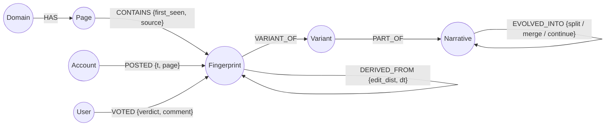
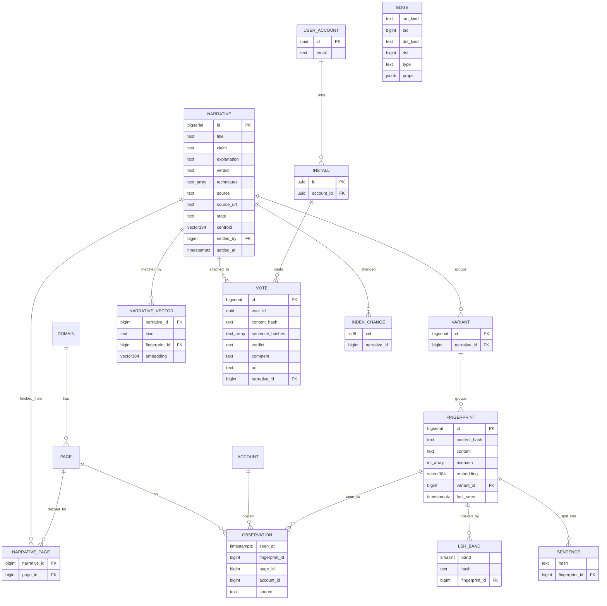
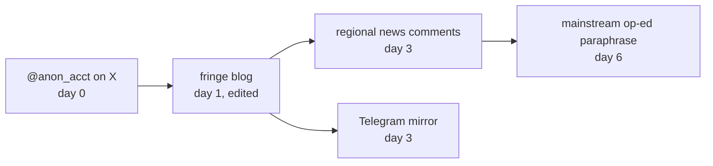

# Data model

Content is identified at three levels:

- Exact: the same text, matched by SHA-256 of the normalised text.
- Variant: an edited copy, matched by MinHash over word shingles with LSH.
- Narrative: the same claim in different words, matched by cosine between a block's embedding and the narrative's vectors.

Fingerprints enter the database when the backend fetches a public page. Reports, detection hits from clients and EUvsDisinfo cases each trigger a fetch of the page they point to, so the graph grows wherever known narratives appear. Detection hits also record that a known variant was seen at a public URL, which gives the reach and spread of a narrative.

## Graph

Two edge types describe how narratives evolve:

- `DERIVED_FROM` links a fingerprint to the most similar fingerprint seen earlier. The edges form a family tree of mutations within a narrative, showing which accounts and domains introduced each change.
- `EVOLVED_INTO` links a narrative cluster in one time window to its matching clusters in the next, recording splits, merges and drift.

A signature is the shipped form of a narrative in state `active`, `under_review` or `disputed`: its verdict, techniques, explanation and the match data clients need.

## Storage schema

All of it lives in Postgres with pgvector. Graph edges that have no table of their own sit in a generic `edge` table. Ids are `bigserial` except the voter and account ids, which are uuids. The migrations in `backend/migrations/` are the source for columns.

`vote`, `sentence`, `narrative_vector`, `narrative_page`, `index_change` and `install` serve the API and the index. `eval_case` holds the evaluation's held-out EUvsDisinfo cases and `cluster_run` one row per clustering run. `login_token` and `job` support sign-in and the queue.

`observation.source` is `fetch` or `detection`. Detection observations reference existing fingerprints only, and their account is the poster on the page, never the extension user.

## Example lineage

The `DERIVED_FROM` tree of one narrative, read in the direction of spread:

