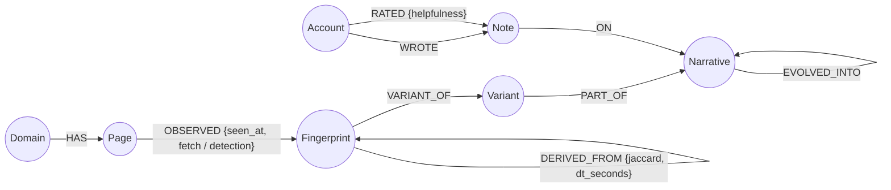
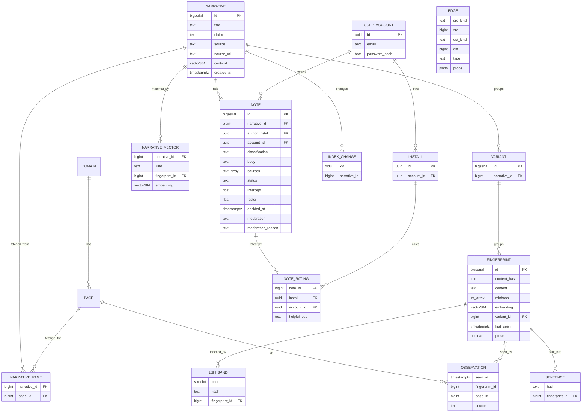

# Data model

Content is recognised at three levels:

- Exact: a shared sentence hash, SHA-256 over the normalised sentence.
- Variant: an edited copy, found by MinHash over word 5-grams with LSH bands and confirmed at an estimated Jaccard of 0.5.
- Narrative: the same claim in other words, found by cosine between an embedding unit and the narrative's vectors, at the `narrative` level from `NARRATIVE_MATCH_THRESHOLD` and the weaker `related` level from `RELATED_MATCH_THRESHOLD`.

Fingerprints enter the database when a note's passage is stored and when the backend fetches a public page. Notes and detection hits each enqueue a fetch of the page they point to, and the fetch attaches the blocks that carry the narrative, so the graph grows wherever the narrative is seen. Observations record each sighting with its time and page and feed the narrative's spread.

## Graph

`DERIVED_FROM` links a fingerprint to the closest earlier-seen near-duplicate, so the edges form a family tree of edits within a narrative. `EVOLVED_INTO` links a cluster candidate to the earlier narrative it grew out of.

A narrative has a `source`. A `note` narrative is created by `POST /notes`, its claim the passage, and ships to clients while it has a note that is not hidden. A `cluster` narrative is a candidate the `cluster` job found among unassigned fingerprints; it never ships.

## Storage schema

Everything lives in Postgres with TimescaleDB and pgvector. Graph edges sit in a generic `edge` table. Ids are `bigserial` except accounts and installs, which are uuids. The migrations in `backend/migrations/` are the source for columns, and the diagram shows the ones the code reads.

`observation` is a TimescaleDB hypertable on `seen_at`, and the continuous aggregates `narrative_hits_hourly` and `narrative_domain_daily` feed the dashboard's spread charts. Triggers on `note`, `note_rating` and `narrative_vector` write `index_change` rows, which `/index` turns into deltas. `job` is the work queue, `cluster_run` holds one row per clustering run, and `eval_case` holds the offline benchmark's cases in the benchmark's own database. `observation.source` is `fetch` or `detection`; a detection observation references an existing fingerprint and never identifies the extension user.
